

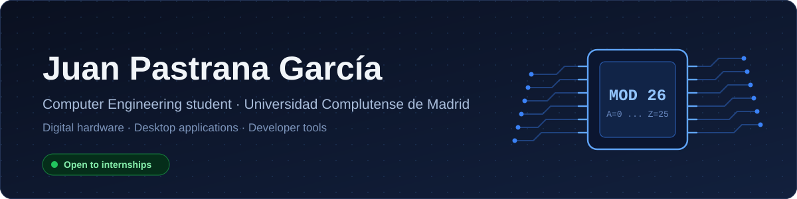

&nbsp;

&nbsp;

Third-year Computer Engineering student. I like building things end to end, from digital logic on an FPGA to desktop apps with a real user interface.

## Featured projects

<table>
<tr>
<td width="96" valign="top"></td>
<td>

<h3>FPGA Enigma Machine</h3>

The Enigma cipher rebuilt as digital logic in VHDL on a Basys 3 (Artix-7) FPGA, instead of simulated in software. It includes a control FSM, button debouncing, a MOD 26 ALU, rotor stepping and a multiplexed 7-segment display. Team project for *Tecnología de Computadores* at UCM.

</td>
</tr>
</table>

<a href="https://github.com/J-O-Systems/FPGA-Enigma-Machine">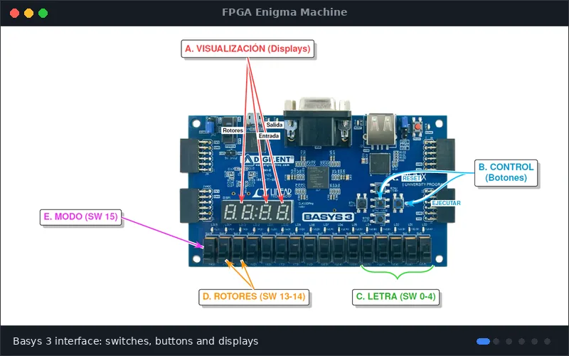</a>

<table align="center">
<tr>
<td align="center"><a href="https://github.com/J-O-Systems/FPGA-Enigma-Machine/blob/main/assets/manual_interface.png">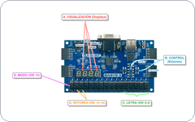</a></td>
<td align="center"><a href="https://github.com/J-O-Systems/FPGA-Enigma-Machine/blob/main/assets/rtl_top.png">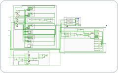</a></td>
<td align="center"><a href="https://github.com/J-O-Systems/FPGA-Enigma-Machine/blob/main/assets/concept_datapath.png">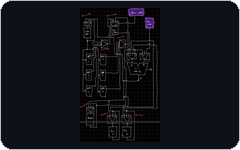</a></td>
<td align="center"><a href="https://github.com/J-O-Systems/FPGA-Enigma-Machine/blob/main/assets/fsm_sketch.png">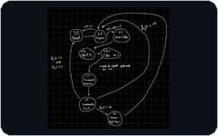</a></td>
<td align="center"><a href="https://github.com/J-O-Systems/FPGA-Enigma-Machine/blob/main/assets/rtl_fsm.png">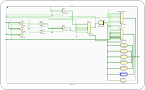</a></td>
<td align="center"><a href="https://github.com/J-O-Systems/FPGA-Enigma-Machine/blob/main/assets/rtl_alu.png">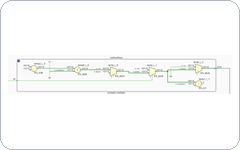</a></td>
</tr>
<tr>
<td align="center">Board</td>
<td align="center">Top RTL</td>
<td align="center">Datapath</td>
<td align="center">FSM sketch</td>
<td align="center">FSM RTL</td>
<td align="center">ALU RTL</td>
</tr>
</table>

Click any thumbnail to open it full size.

 

<table>
<tr>
<td width="96" valign="top"></td>
<td>

<h3>MC ServerLauncher</h3>

Desktop app to create and manage Minecraft servers from a graphical interface. Multi-server management, live console, and a mod and plugin manager.

</td>
</tr>
</table>

<a href="https://github.com/JuanP-G/MC-ServerLauncher">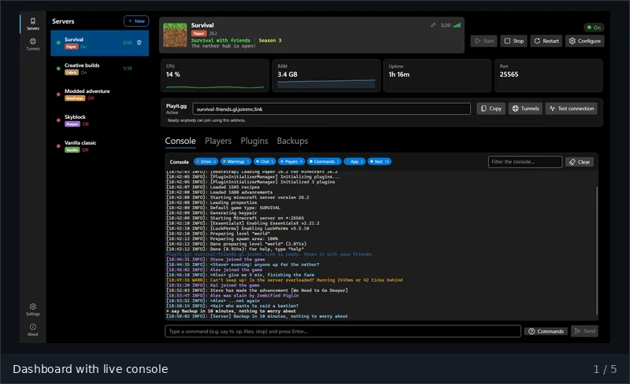</a>

<table align="center">
<tr>
<td align="center"><a href="https://github.com/JuanP-G/MC-ServerLauncher/blob/main/docs/screenshots/main.png">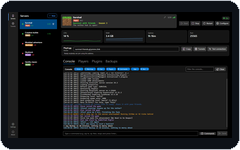</a></td>
<td align="center"><a href="https://github.com/JuanP-G/MC-ServerLauncher/blob/main/docs/screenshots/new-server.png">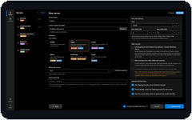</a></td>
<td align="center"><a href="https://github.com/JuanP-G/MC-ServerLauncher/blob/main/docs/screenshots/mods-plugins.png">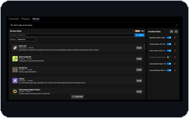</a></td>
<td align="center"><a href="https://github.com/JuanP-G/MC-ServerLauncher/blob/main/docs/screenshots/players.png">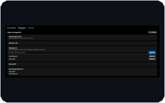</a></td>
<td align="center"><a href="https://github.com/JuanP-G/MC-ServerLauncher/blob/main/docs/screenshots/settings.png">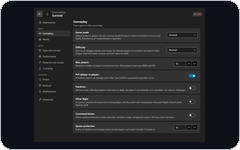</a></td>
</tr>
<tr>
<td align="center">Dashboard</td>
<td align="center">New server</td>
<td align="center">Mods</td>
<td align="center">Players</td>
<td align="center">Settings</td>
</tr>
</table>

 

<table>
<tr>
<td width="96" valign="top"></td>
<td>

<h3>RLAnalyzer</h3>

Rocket League replay analysis with statistics and interactive dashboards. Python backend, React web interface and an Electron desktop shell.

</td>
</tr>
</table>

<a href="https://github.com/JuanP-G/RLAnalyzer">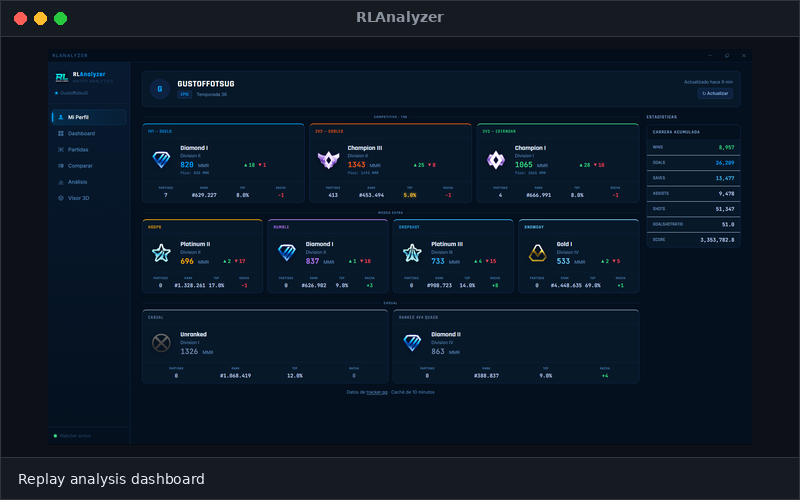</a>

## Skills

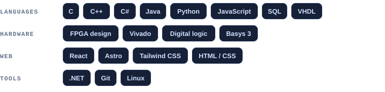

## Education

**Universidad Complutense de Madrid** · Degree in Computer Engineering · 3rd year, expected 2028

Languages: Spanish (native) · English (advanced)
