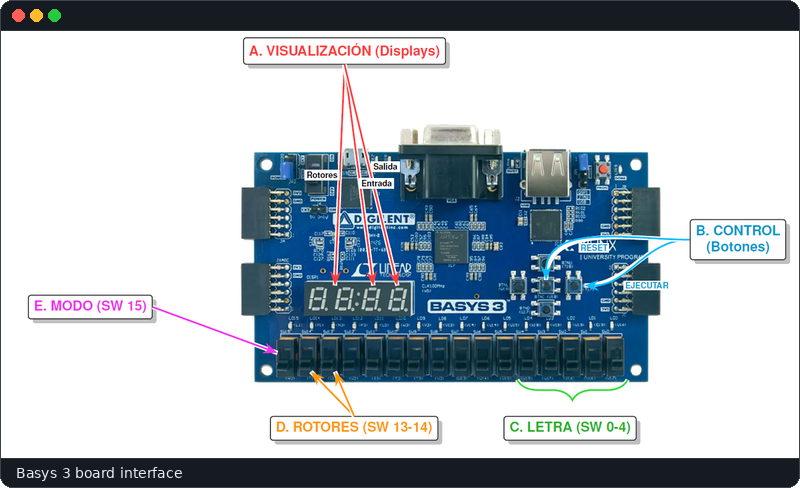
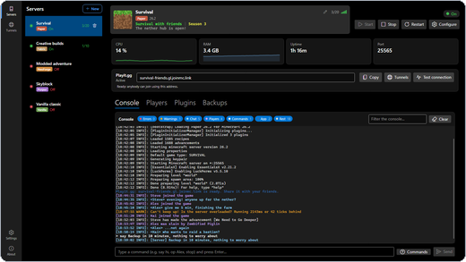
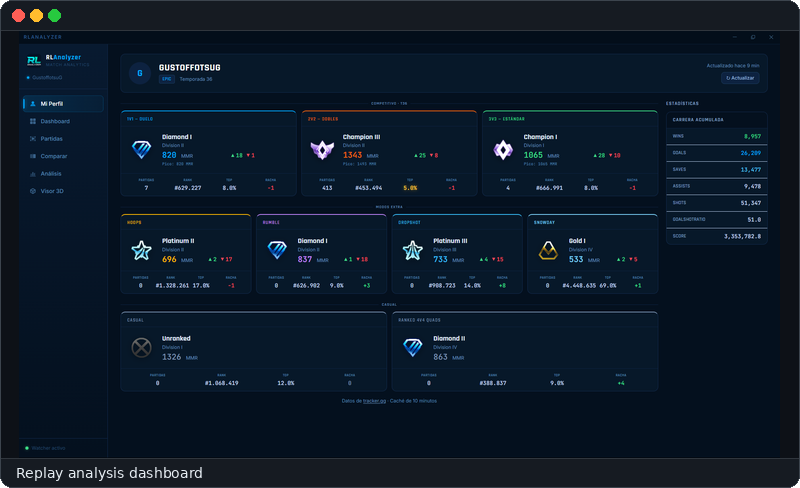

<h1 align="center">Juan Pastrana García</h1>

Computer Engineering student · Universidad Complutense de Madrid 
Digital hardware · Desktop applications · Developer tools

<h2 align="center">Projects</h2>

<table>
<tr>
<td width="50%" align="center" valign="middle">

</td>
<td width="50%" align="center" valign="middle">

<h3 align="center">FPGA Enigma Machine</h3>

The Enigma cipher rebuilt as digital logic in VHDL on a Basys 3 FPGA, not simulated in software: control FSM, button debouncing, MOD 26 ALU, rotors and a 7-segment display. Team project for <i>Tecnología de Computadores</i> at UCM.

VHDL · Vivado · Basys 3

</td>
</tr>
<tr>
<td width="50%" align="center" valign="top">

<h3 align="center">MC ServerLauncher</h3>

Desktop app to create and manage Minecraft servers: multi-server management, live console, mods and plugins.

C# · .NET 9 · Avalonia

</td>
<td width="50%" align="center" valign="top">

<h3 align="center">RLAnalyzer</h3>

Rocket League replay analysis with statistics and interactive dashboards, in a desktop app.

Python · FastAPI · React · Electron

</td>
</tr>
<tr>
<td width="50%" align="center" valign="middle">

</td>
<td width="50%" align="center" valign="middle">

</td>
</tr>
</table>

<h2 align="center">Skills</h2>

 
Also VHDL and FPGA design with Vivado

<h2 align="center">Education</h2>

<b>Universidad Complutense de Madrid</b> · Degree in Computer Engineering · 3rd year, expected 2028 
Spanish (native) · English (advanced)

