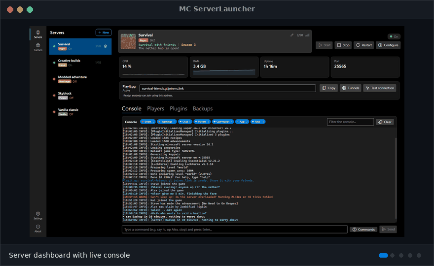

# Juan Pastrana García

**Computer Engineering student · Universidad Complutense de Madrid**

Digital hardware, desktop applications and developer tools

---

## Featured projects

### FPGA Enigma Machine

Hardware implementation of the Enigma cipher in VHDL, running on a Basys 3 (Artix-7) FPGA. It rebuilds the machine as digital logic instead of simulating it: a control FSM with button debouncing, a MOD 26 ALU, rotor stepping and a multiplexed 7-segment display. Team project for *Tecnología de Computadores* at UCM.

  
  
  
  

  

### MC ServerLauncher

Desktop application to create and manage Minecraft servers through a graphical interface. Multi-server management, live console and mod manager.

  
  
  

  

### RLAnalyzer

Rocket League replay analysis with interactive statistics and a web interface.

  
  
  

  

---

## Skills

**Hardware:** VHDL, FPGA design with Vivado
